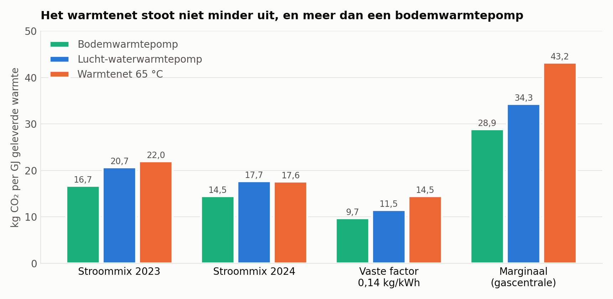
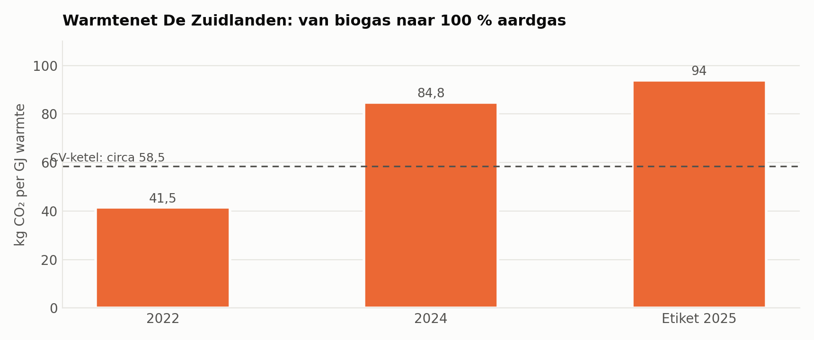
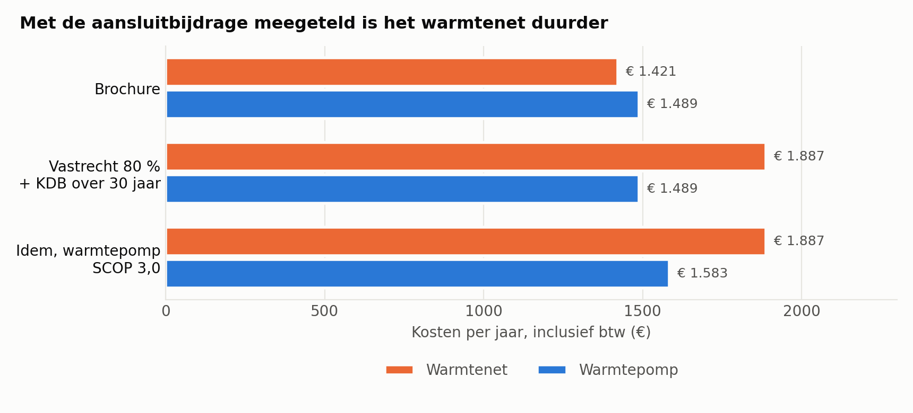
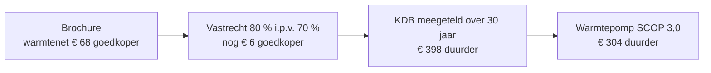
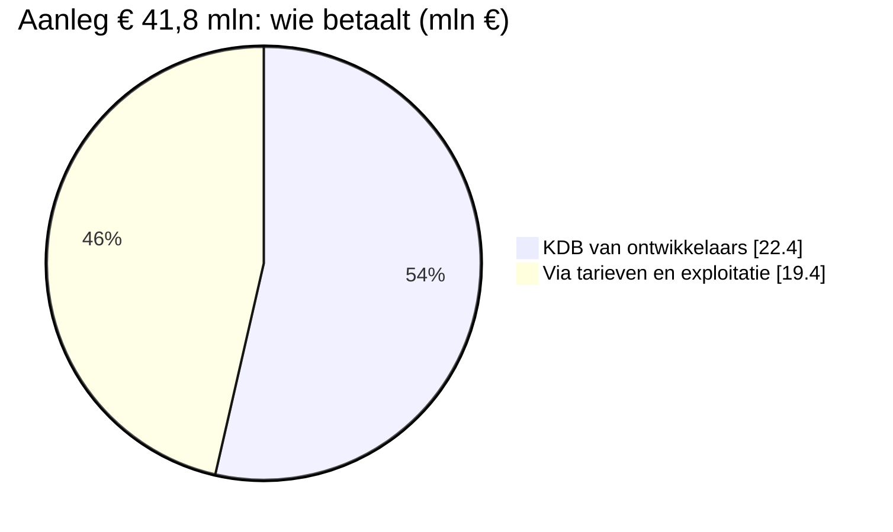
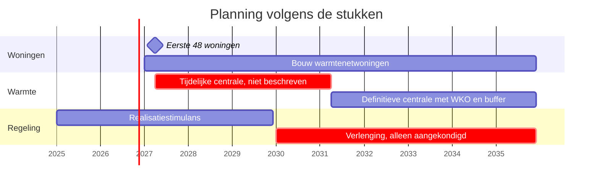
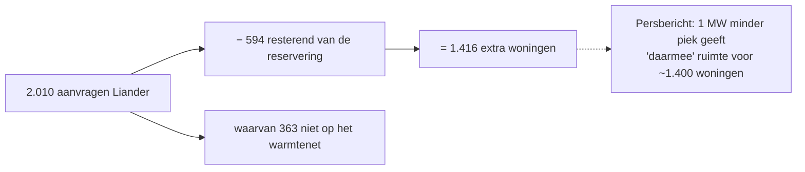
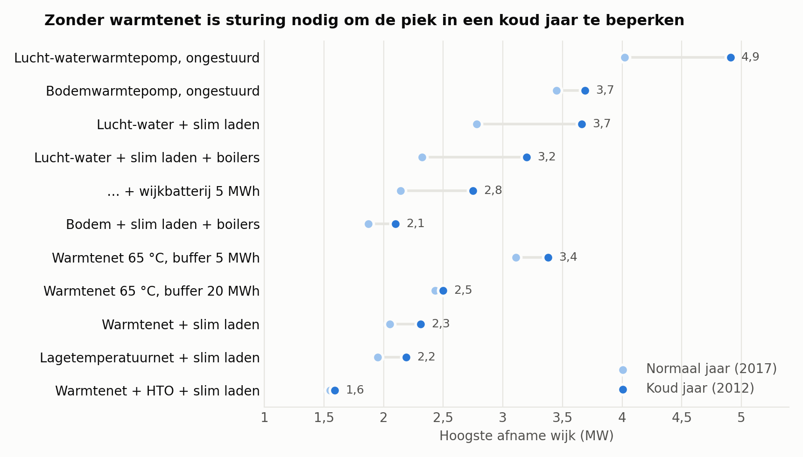
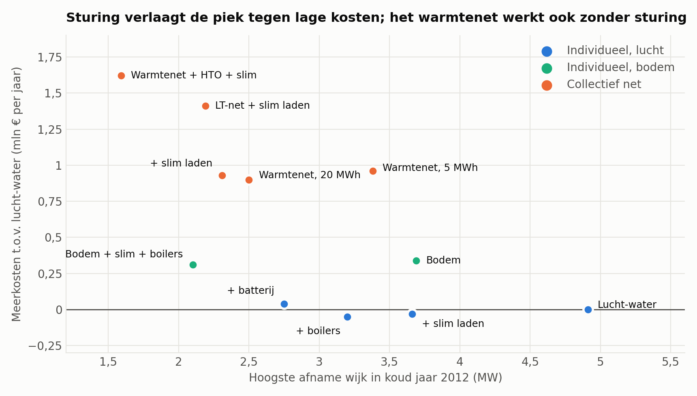
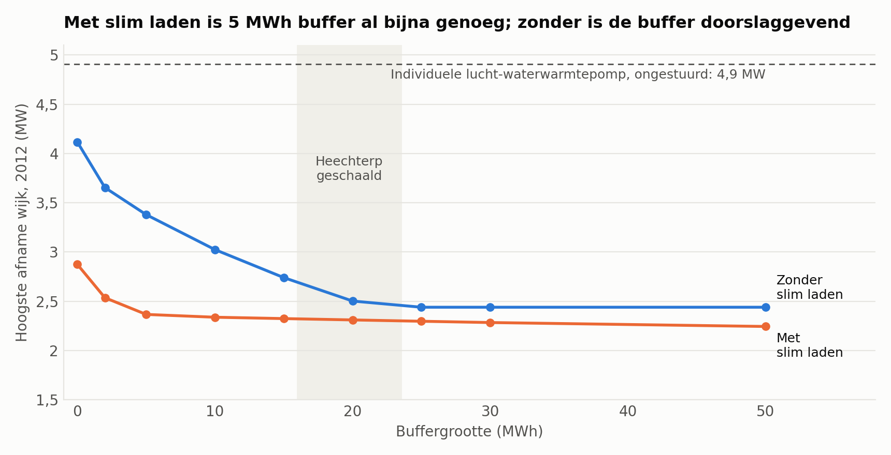

# Warmtenet Middelsee: wat niet klopt in het voorstel

De gemeenteraad van Leeuwarden besluit op **23 november 2026** over een warmtenet van **€ 41,8 mln** voor 1.647 nieuwbouwwoningen in Middelsee. Dit stuk zet 25 punten op een rij waarop het voorstel niet klopt of slecht onderbouwd is.

> **Onafhankelijke analyse, geen publicatie van de gemeente.** Stand 5 november 2026. De gemeente is niet om een reactie gevraagd. Deel A is na te rekenen uit de [stukken van de gemeente](#bronnen). Deel B komt uit een eigen, indicatief model. De businesscase is geheim en niet ingezien.

## In het kort

- **Voor huiseigenaren is het warmtenet duurder dan de brochure laat zien.** Niet € 68 per jaar goedkoper, maar € 304–398 per jaar duurder: **€ 9.000–12.000 per woning over 30 jaar**.
- **Het warmtenet is niet schoner dan individuele warmtepompen.** Het stoot in het model 21–50 % meer CO₂ uit dan bodemwarmtepompen en 0–26 % meer dan lucht-waterwarmtepompen, en vraagt 23–51 % meer stroom.
- **Aan de overkant is te zien hoe het kan lopen.** Het warmtenet in Techum zou op biogas draaien met meer dan 50 % CO₂-reductie. Volgens het eigen warmte-etiket van de exploitant draait het nu op 100 % aardgas, met 44 % warmteverlies en meer uitstoot dan een cv-ketel.
- **Getallen kloppen niet.** De aansluitbijdrage telt niet op tot het genoemde totaal en verschilt tot 55 % tussen de stukken.
- **De netwinst, de hoofdreden, komt laat.** De installatie die de netwinst levert, draait pas in 2031. De "1.400 extra woningen" volgen niet uit de genoemde 1 MW.
- **Het warmtenet wordt alleen vergeleken met het slechtste alternatief.** In het model haalt een bodemwarmtepomp met sturing een lagere piek met een derde minder stroom.

Het warmtenet verlaagt in het model wel degelijk de piek. [Lees ook wat dit stuk niet beweert](#wat-dit-stuk-niet-beweert).

## CO₂ en stroom: warmtenet tegen individuele warmtepompen

De stukken noemen het warmtenet "duurzaam", maar geven geen CO₂-uitstoot of stroomverbruik. In dit eigen, indicatieve model is het warmtenet niet schoner dan de individuele warmtepompen waarmee het zou moeten concurreren.

| Warmte voor 1.647 woningen + utiliteit | Bodem | Lucht-water | Warmtenet | Warmtenet t.o.v. bodem | Warmtenet t.o.v. lucht-water |
|---|---:|---:|---:|---:|---:|
| Stroom voor warmte, normaal jaar (GWh) | 2,90 | 3,57 | 4,38 | **+51 %** | **+23 %** |
| CO₂, stroommix 2023 (kg/GJ) | 16,7 | 20,7 | 22,0 | **+31 %** | +6 % |
| CO₂, stroommix 2024 (kg/GJ) | 14,5 | 17,7 | 17,6 | **+21 %** | gelijk |
| CO₂, vaste factor 0,14 kg/kWh (kg/GJ) | 9,7 | 11,5 | 14,5 | **+50 %** | **+26 %** |
| CO₂, marginale gascentrale (kg/GJ) | 28,9 | 34,3 | 43,2 | **+50 %** | **+26 %** |
| CO₂, stroommix 2023 (ton per jaar) | 671 | 833 | 881 | +210 ton | +48 ton |

- **Waarom het verschil met lucht-water soms wegvalt.** Op de uurmix profiteert het warmtenet van zijn buffer: het neemt stroom af op schonere uren. Het model kent die uren vooraf, dus dit voordeel is optimistisch. De individuele warmtepompen hebben in deze tabel geen sturing; bodem met slim gestuurde boilers komt op 15,3 kg/GJ (2023).
- **Onzekerheid.** De COP (3,5) en het netverlies (25 %) zijn aannames, omdat ze niet in de stukken staan. Bij een lagere COP vraagt het warmtenet tot 41 % meer stroom dan lucht-water en 74 % meer dan bodem; bij 15 % netverlies 9 % meer dan lucht-water.
- **Afbakening.** Alleen stroom voor warmte, productie in Nederland zonder import, geen materialen en aanleg. De uitstoot van de tijdelijke centrale tot 2031 is onbekend en niet meegerekend. Bij een schonere stroommix krimpen de absolute verschillen, de procentuele minder.

## Het voorbeeld van de overkant: Techum

Techum en Jabikswoude, in dezelfde wijk De Zuidlanden, hebben al een warmtenet van Ennatuurlijk voor zo'n 750 huishoudens. Dat is dezelfde partij waarmee de gemeente volgens het raadsvoorstel nu in gesprek is over Middelsee.

| | Beloofd | Warmte-etiket 2025 |
|---|---|---|
| Warmtebron | Biogas uit mest van een melkveebedrijf | **100 % aardgas, 0 % hernieuwbaar** |
| CO₂ | Meer dan 50 % reductie | **94 kg/GJ, "besparing" −61 %** |
| Warmteverlies | | **44 %** |

- **Bronnen.** De huidige cijfers komen van het [warmte-etiket van Ennatuurlijk](https://ennatuurlijk.nl/leveringsservice/in-jouw-buurt/warmte-etiket-ennatuurlijk). Het verloop 2022–2024 komt van [Warmtenetwerk](https://warmtenetwerk.nl/warmteproject/warmtenet-leeuwarden/). De belofte komt uit een [VVD-pagina uit circa 2010](https://vvd-leeuwarden.nl/index.php/archief/1484-vvd-stelt-vragen-over-problemen-stadsverwarming-techum-de-zuidlanden), dus tweedehands. Daar staat ook dat de kosten "nooit meer" zouden zijn dan bij conventionele verwarming; dat is hier niet getoetst.
- **Wat het zegt over Middelsee.** Middelsee wordt elektrisch en gemeentelijk en is dus een ander systeem. De les gaat over beloften: een warmtebron en een duurzaamheidsclaim kunnen veranderen terwijl bewoners aangesloten blijven. In het huidige voorstel is de bron van de tijdelijke centrale tot 2031 niet beschreven.
- **Wat het zegt over het model.** Dit stuk rekent met 25 % netverlies. Bij de 44 % van de buren zou Middelsee 5,9 GWh stroom voor warmte vragen: 64 % meer dan lucht-water en twee keer zoveel als bodem. Dat is een gevoeligheid en geen voorspelling, want een ouder net is niet zonder meer vergelijkbaar.

## A. Aantoonbaar uit de stukken

### Kosten voor huiseigenaren

1. **De brochure telt de warmtepomp op twee plekken, de aansluitbijdrage op één.** De € 14.000 voor de warmtepomp staat bij "Kosten ontwikkelaar" en komt terug als € 933 afschrijving bij "Kosten bewoner". De kostendekkingsbijdrage (KDB) staat alleen bij de ontwikkelaar, terwijl die via de woningprijs ook bij de koper terechtkomt. Zo lijkt het warmtenet € 68 per jaar goedkoper (€ 1.421 tegen € 1.489).
2. **Het vastrecht in de brochure is te laag.** Brochure: € 430,50 (70 % van het ACM-maximum). Raadsvoorstel: € 492,53 (80 %). Dat is € 62 per jaar.
3. **Eerlijk gerekend is het warmtenet duurder.** Met de KDB van € 10.000 ex btw (€ 12.100) over 30 jaar en het vastrecht uit het raadsvoorstel kost het warmtenet € 1.887 per jaar, tegen € 1.489 voor de warmtepomp: **€ 398 per jaar meer**. Ook met een minder gunstige warmtepomp (SCOP 3,0 in plaats van de 3,7 uit de brochure) blijft het € 304. Over 30 jaar, inclusief twee warmtepompen en zonder prijsstijgingen, is dat **€ 9.000–12.000 per woning**.
4. **De aansluitbijdrage verschilt per stuk.** Raadsvoorstel: circa € 10.000 ex btw, dus € 12.100. Brochure: € 15.000–18.755, dus 24–55 % hoger.
5. **Bij de hogere bedragen loopt het verschil verder op.** Met de KDB uit de brochure is het warmtenet € 494–619 per jaar duurder (€ 12.000–18.600 over 30 jaar).
6. **"Geen onderhoud" kost wel geld.** De brochure noemt € 0 onderhoud voor het warmtenet, tegen € 150 bij de warmtepomp. Bewoners betalen wel € 212 per jaar aan huur en meettarief.
7. **Koeling ontbreekt in de vergelijking.** Woningen krijgen geen collectieve koeling. Een omkeerbare warmtepomp kan vaak wel koelen. De kosten van airco of zonwering staan nergens.
8. **Bewoners dragen een risicobuffer.** De brochure noemt het warmtebedrijf "zonder winstoogmerk". De businesscase verwacht een resultaat van € 7,7 mln (circa € 4.700 per woning), bedoeld voor risico's en mogelijk later "voor overige warmteprojecten".
9. **De korting is geen garantie.** De 20 % en 5 % korting heten in het raadsvoorstel "uitgangspunt" en de brochure zegt dat er "geen rechten" aan te ontlenen zijn. Het warmtebedrijf heeft volgens de brochure een monopoliepositie. Overstappen kan niet.

### Financiering

10. **De KDB-som klopt niet met de eigen getallen.** 1.647 woningen × € 12.000 = € 19,8 mln. Het raadsvoorstel noemt € 22,4 mln, "op basis van" die getallen. Het verschil van € 2,6 mln wordt niet verklaard. Utiliteit of indexatie kan meespelen, maar dat staat er niet.
11. **De verlaging met € 2.000 rust op een regeling die niet de hele bouwperiode dekt.** De Realisatiestimulans is € 7.000 per *betaalbare* woning met bouwstart in 2025–2029. De bouw loopt tot circa 2035, en verlenging is alleen "aangekondigd". Zonder stimulans is de KDB € 12.000, wat het raadsvoorstel zelf "relatief hoog" noemt. Samen is dit € 3,3 mln publiek geld dat niet in de bewonersvergelijking zichtbaar is.
12. **Bijna de helft van de aanleg moet via tarieven terugkomen.** Aanleg € 41,8 mln, oftewel € 25.400 per woning ex btw. De KDB dekt 54 %. De rest plus € 2,9 mln bouwrente staat na realisatie als € 22,4 mln op de gemeentelijke balans.

### Netcongestie, de hoofdreden

13. **De 1.400 woningen volgen niet uit de 1 MW.** Het persbericht zegt dat 1 MW minder piek "daarmee" ruimte geeft voor ongeveer 1.400 extra woningen. De 1.416 in het raadsvoorstel is een telling: 2.010 aanvragen min 594 resterende reservering. Daarin zitten 363 woningen die niet op het warmtenet komen.
14. **De installatie die de netwinst levert, draait pas in Q2 2031.** De eerste woningen komen in april 2027. De capaciteit wordt nu al toegerekend aan het warmtenet ("het effect ... nu al zichtbaar"). Over de tijdelijke centrale staat alleen dat die er komt: geen bron, geen vermogen, geen netbelasting.
15. **Het onderstation ontbreekt in de afweging.** Boksumerdyk is de oorzaak van het probleem, maar er staat geen nieuwe datum in het raadsvoorstel. De raad kan dus niet zien hoeveel jaar het warmtenet het netprobleem echt oplost.
16. **Prijs van de winst met de eigen cijfers.** € 41,8 mln min € 19,1 mln aan vermeden warmtepompen is € 22,7 mln extra investering voor "maximaal 1 MW". Warmtepompen moeten wel eerder vervangen worden, dus dit is een eerste indruk en geen levensduurvergelijking (zie punt 21).
17. **Laadpalen komen niet voor.** Het raadsvoorstel noemt laden en elektrische auto's nergens, terwijl die mede de avondpiek bepalen.

### Overige fouten

18. **Buitenunits in de verkeerde kolom.** Brochure p. 6: "Ontsierende buitenunits" staat bij het warmtenet en "Geen ontsierende buitenunits" bij de warmtepomp.
19. **Boksumerhoeke.** Volgens het raadsvoorstel hoort deze buurt bij de 1.647 woningen, volgens het persbericht is het een latere uitbreiding, en de kaart in de brochure sluit de buurt uit.
20. **"Draait op duurzaam opgewekte energie".** Dit staat in de brochure zonder onderbouwing. De warmtepompen draaien op netstroom. Ook het jaarlijkse stroomverbruik, het netverlies en de buffergrootte staan nergens in de stukken, terwijl het raadsvoorstel "zo efficiënt mogelijk" als uitgangspunt noemt.

## B. Slechte of slecht onderbouwde keuzes

*Uitkomsten van een eigen uurmodel met KNMI-weer, indicatief. Kosten zijn maatschappelijk: zonder btw, belasting en subsidie. Veel kostenposten zijn eigen aannames. Vermeden netverzwaring en bouwvertraging zijn niet meegerekend.*

21. **Duur als piekmaatregel.** Maatschappelijk circa € 0,9–1,2 mln per jaar meer dan lucht-waterwarmtepompen (€ 550–750 per woning).
22. **Alleen vergeleken met het slechtste alternatief.** De stukken zetten het warmtenet alleen af tegen de lucht-waterwarmtepomp, de variant met de hoogste piek. Bodemwarmtepompen en een bronnet komen niet voor.

| Variant, koud jaar | Piek | Stroom voor warmte | Meerkosten per jaar |
|---|---:|---:|---:|
| Lucht-water, ongestuurd | 4,9 MW | 3,6 GWh | referentie |
| Warmtenet 65 °C, 20 MWh buffer | 2,5 MW | 4,4 GWh | € 0,9–1,2 mln |
| Bodem + slim laden + boilers (€ 20.000) | 2,1 MW | 2,9 GWh | € 0,3–0,5 mln |

Dezelfde of lagere piek, een derde minder stroom en lagere kosten dan het warmtenet. De kanttekeningen: de woningprijs (bij € 25.000 valt het voordeel grotendeels weg), de ruimte voor bronnen en de afhankelijkheid van sturing.

23. **65 °C voor woningen met vloerverwarming.** De brochure toont vloerverwarming, die op circa 35 °C werkt. Ruimteverwarming is 60 % van de warmtevraag (12 van 20 GJ, eigen verdeling). Alleen tapwater heeft de hoge temperatuur nodig, en het hele net houdt die temperatuur wel aan. Gevolg: 23–41 % meer stroom dan lucht-water en 51–74 % meer dan bodem, zie [CO₂ en stroom](#co-en-stroom-warmtenet-tegen-individuele-warmtepompen). Het aangenomen netverlies van circa 25 % staat gelijk aan de warmte van circa 670 woningen per jaar.
24. **Slim laden ontbreekt.** Dit levert 1,2 MW piekverlaging tegen vrijwel geen meerkosten, en zou ook bovenop het warmtenet werken (2,50 → 2,31 MW). Afdwingbaarheid is de kanttekening.
25. **De buffer lijkt krap als die op Heechterp lijkt.** Daar is de buffer circa 400 m³ voor 1.140 woningen; geschaald is dat circa 23 MWh. Met warmteprofielen uit de [TNO-generator](https://energy.nl/tools/warmteprofielengenerator/) is voor dezelfde piek circa 50 MWh nodig. De buffergrootte van Middelsee zelf is niet bekend, dus dit is geen vaststaande fout.

## Wat dit stuk niet beweert

- **Niet dat het warmtenet niet werkt.** Als enkele maatregel geeft het in het model de grootste piekverlaging (1,6–2,4 MW), en "twee keer zoveel woningen" is te reproduceren.
- **Niet dat een lagetemperatuurnet beter is.** Het is zuiniger, maar in de raming € 0,5 mln per jaar duurder door de boosters.
- **Niet dat het warmtenet altijd meer CO₂ uitstoot dan lucht-water.** Op de stroommix van 2023–2024 is het daar vrijwel gelijk aan. Bij een vaste of marginale factor is het 26 % meer. Tegenover bodem is het in alle varianten meer.
- **Niet dat alternatieven niet onderzocht zijn.** Ze staan niet in de stukken aan de raad; de Arcadis-studie en de businesscase zijn niet ingezien.
- **Niet dat Middelsee afloopt zoals Techum,** en niet dat Techum duurder is geworden: daarvoor zijn hier geen cijfers.
- **Niet dat bewoners netto verliezen.** De brochure noemt voordelen die hier niet in euro's zijn uitgedrukt: ruimte, geen geluid, geen eigen installatie.

## Bronnen

**Stukken van de gemeente Leeuwarden**

- [Raadsvoorstel 2026-282643](bronnen/Raadsvoorstel_Warmtenet_Middelsee.pdf)
- [Persbericht](bronnen/Persbericht_Warmtenet_Middelsee.pdf)
- [Bijlage 10, informatiebrochure ontwikkelaars](bronnen/Bijlage_10_Informatiebrochure.pdf)

**Rapporten van derden**

- [Aanbesteding warmtepompen Heechterp, TenderNed 419282](https://www.tenderned.nl/papi/tenderned-rs-tns/v2/publicaties/419282/documenten/14070116/content)
- [RVO/BDH, Netimpact woningen met warmtepomp (2025)](https://www.rvo.nl/sites/default/files/2025-02/Rapport-Netimpact-woningen-met-warmtepomp.pdf)
- [CE Delft, Hogetemperatuuropslag (2026)](https://ce.nl/wp-content/uploads/2026/08/CE_Delft_Greenvis_250503_Hogetemperatuuropslag_Def.pdf)
- [TNO, Warmtevraagprofielen voor buurten (2022)](https://publications.tno.nl/publication/34639576/DVlZDB/TNO-2022-P10336.pdf)
- [Netbeheer Nederland, meta-analyse warmtenetten (2025)](https://www.netbeheernederland.nl/sites/default/files/2025-05/slides_meta-analyse_nbnl_warmtenetten_final_2.0_-_28_04_2025.pdf)

**Warmtenet De Zuidlanden (Techum)**

- [Warmte-etiket Ennatuurlijk](https://ennatuurlijk.nl/leveringsservice/in-jouw-buurt/warmte-etiket-ennatuurlijk), [Warmtenet Leeuwarden, Ennatuurlijk](https://ennatuurlijk.nl/jouw-buurt/warmtenet-leeuwarden)
- [Warmtenetwerk, project Leeuwarden](https://warmtenetwerk.nl/warmteproject/warmtenet-leeuwarden/)
- [VVD Leeuwarden over stadsverwarming Techum](https://vvd-leeuwarden.nl/index.php/archief/1484-vvd-stelt-vragen-over-problemen-stadsverwarming-techum-de-zuidlanden)

**Doorrekening**

- [Achtergrondrapport met methode, aannames en beperkingen](rapport/analyse_middelsee.md)
- [Brondata](https://github.com/Rinze-Smits/warmtenet-middelsee/tree/main/data), [model](https://github.com/Rinze-Smits/warmtenet-middelsee/tree/main/model) en [uitkomsten](https://github.com/Rinze-Smits/warmtenet-middelsee/tree/main/uitvoer)
