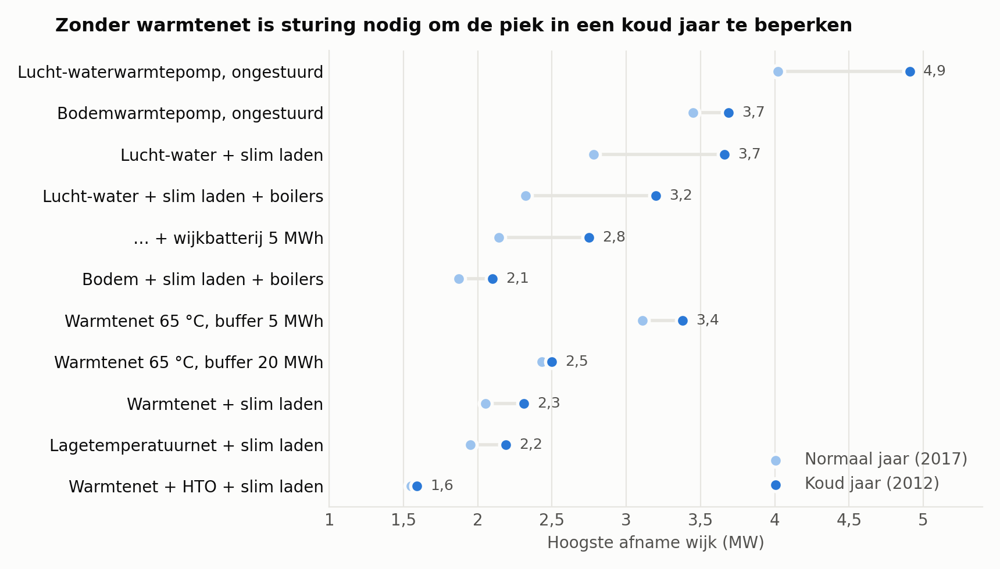
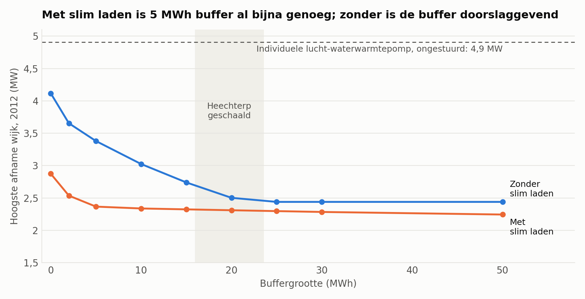
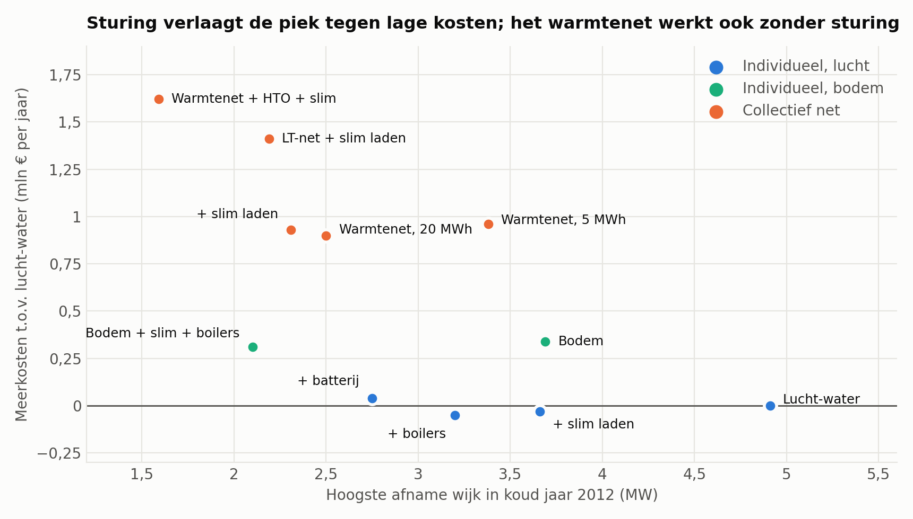

# Warmtenet Middelsee: doorrekening van voorstel en alternatieven

*Achtergrondrapport, 5 november 2026. Niet extern getoetst en geen wederhoor gepleegd. De modeluitkomsten zijn indicatief.*

## 1. Kern

1. **Het voorstel doet op hoofdlijnen wat het belooft.** Het warmtenet verlaagt de wijkpiek ten opzichte van individuele lucht-waterwarmtepompen met 1,6 MW in een normaal jaar en 2,4 MW in een koud jaar, bij 20 MWh buffer en goede regeling. Als enkele maatregel is het de sterkste, wat aansluit bij het raadsvoorstel ("de grootste bijdrage").
2. **De winst hangt aan de buffer en de regeling, en die staan niet in de stukken.** Zonder buffer blijft 0,2–0,8 MW over. Met TNO-warmteprofielen is mogelijk circa 50 MWh nodig in plaats van 20 MWh, en bij de hogere warmtevraag van die tool daalt de winst naar 0,6–1,0 MW. Met 20 MWh zonder vaste vermogensgrens kan de winst in de bedrijfsvoering grotendeels verloren gaan (piek 3,6–3,9 MW in plaats van 2,4–2,8 MW).
3. **Na het warmtenet zit de restpiek in huishoudens en laadpalen.** Slim laden verlaagt de piek in elke variant, tegen naar schatting vrijwel geen meerkosten. Een buffer boven 5 MWh levert daarna weinig extra op.
4. **Het warmtenet is duurder dan de piek alleen rechtvaardigt, maar het koopt ook zekerheid.** Maatschappelijk kost het circa € 0,9–1,2 mln per jaar meer dan lucht-waterwarmtepompen (€ 550–750 per woning). Lucht-water met slim laden, flexibele boilers en een wijkbatterij haalt 2,1–2,8 MW voor € 0,02–0,06 mln per jaar meer. Die route vraagt echter afspraken die Liander moet accepteren en bewoners moeten naleven; of dat kan, is de echte vraag. Het warmtenet heeft die afhankelijkheid niet. Vermeden netverzwaring en bouwvertraging zitten niet in deze bedragen.
5. **De brochure-vergelijking voor bewoners klopt niet.** De brochure toont het warmtenet € 68 per jaar goedkoper. Met het vastrecht uit het raadsvoorstel en de KDB symmetrisch meegeteld is het € 250–400 per jaar duurder.
6. **Openstaand en mogelijk het belangrijkst: de timing.** De definitieve centrale komt in Q2 2031. Het raadsvoorstel zegt niet hoe de tijdelijke voorziening de piek beperkt, en noemt geen nieuwe datum voor onderstation Boksumerdyk. Als het onderstation rond 2031 gereed is, kan de netwinst deels overbodig blijken op het moment dat ze beschikbaar komt.

## 2. Resultaten per variant

Basis: KNMI Leeuwarden, normaal jaar 2017 en koud jaar 2012 (−10,5 °C etmaalgemiddeld, gelijk aan de ontwerpconditie in de aanbesteding Heechterp). Inclusief huishoudens, 2,8 GWh elektrisch rijden en utiliteit. Kosten: maatschappelijk, zonder btw, belasting en subsidie, 3 % en 5 % discontovoet, uurprijzen 2023. Prijzen van 2024 geven vrijwel dezelfde verschillen.

| Variant | Piek normaal jaar (MW) | Piek koud jaar (MW) | Stroom voor warmte (GWh/jaar) | Meerkosten t.o.v. lucht-water (mln €/jaar, 3–5 %) | CO₂ warmte 2023 (kg/GJ) |
|---|---:|---:|---:|---:|---:|
| Lucht-water, ongestuurd | 4,02 | 4,91 | 3,57 | referentie | 20,7 |
| + slim laden | 2,78 | 3,66 | 3,57 | −0,03 tot −0,02 | 20,7 |
| + flexibele boilers | 2,32 | 3,20 | 3,52 | −0,05 tot −0,04 | 19,0 |
| + wijkbatterij 5 MWh | 2,14 | 2,75 | 3,52 | +0,04 tot +0,06 | 19,1 |
| Bodem, ongestuurd (€ 20.000) | 3,45 | 3,69 | 2,90 | +0,34 tot +0,55 | 16,7 |
| Bodem + slim laden + boilers | 1,87 | 2,10 | 2,90 | +0,31 tot +0,52 | 15,3 |
| Warmtenet 65 °C, buffer 5 MWh | 3,11 | 3,38 | 4,40 | +0,96 tot +1,30 | 24,0 |
| **Warmtenet 65 °C, buffer 20 MWh** | **2,43** | **2,50** | **4,38** | **+0,90 tot +1,24** | **22,0** |
| + slim laden | 2,05 | 2,31 | 4,38 | +0,93 tot +1,27 | 22,0 |
| + wijkbatterij 5 MWh | 2,07 | 2,34 | 4,39 | +1,00 tot +1,36 | 22,7 |
| Buffer 5 + basalt 50 MWh | 2,43 | 2,53 | 4,71 | +1,10 tot +1,47 | 26,1 |
| + HTO 3 GWh + slim laden | 1,55 | 1,59 | 4,76 | +1,62 tot +2,03 | 21,3 |
| Lagetemperatuurnet 50 °C + boosters | 2,49 | 2,50 | 3,73 | +1,38 tot +1,80 | 19,0 |
| LT-net + slim laden | 1,95 | 2,19 | 3,73 | +1,41 tot +1,82 | 19,1 |

De bodemvariant is sterk afhankelijk van de woningprijs: bij € 15.000 is ze goedkoper dan lucht-water (−0,17 tot −0,07), bij € 25.000 duurder (+0,84 tot +1,16). Bij een vaste factor van 0,14 kg/kWh (VEKI 2025) is de CO₂-uitstoot 11,5 (lucht), 14,5 (warmtenet), 12,4 (LT) en 9,7 kg/GJ (bodem). De Wcw-doelstelling van 12,5 kg/GJ voor 2040 komt uit CE Delft (2026); de wettekst is niet gecontroleerd.

### Wat de gevoeligheden laten zien

- **Stroomverbruik warmtenet.** 23 % (CO₂-warmtepomp, aanname COP 3,5) tot 41 % (Carnot-benadering uit de overdracht) meer stroom dan lucht-water. Bij 15 % netverlies daalt dat bij de CO₂-warmtepomp naar 9 %, bij 30 % stijgt het naar 31 %. De echte COP en het netverlies zijn dus de belangrijkste onbekenden voor milieu en kosten.
- **Buffer.** Heechterp heeft circa 400 m³ voor 1.140 woningen (65/30 °C), oftewel 16 MWh. Op Middelsee geschaald is dat circa 23 MWh. Dat ligt net waar de piekwinst in het eigen profiel afvlakt. Met de TNO-profielen is 20 MWh te krap en is circa 50 MWh nodig voor dezelfde piek (zie de toets hieronder).
- **Vaste grens.** Is de grens op een normaal jaar gezet (2,43 MW), dan loopt de piek in 2012 op tot 2,8 MW met 20 MWh en blijft op 2,44 MW met 30 MWh. Bij de lagere Carnot-COP gaat het mis: 4,4 MW met 20 MWh, omdat de energie in een koude periode dan niet meer binnen de grens past.
- **Voorkennis is niet de zwakke plek.** Een eenvoudige regel (onder de grens de buffer vol houden) bereikt zonder voorspelling dezelfde waarden als het optimalisatiemodel. Een rollende optimalisatie met voorspelfout doet dat alleen met die regel; zonder grens blijft 3,6–3,9 MW over.
- **Dagritme in de warmtevraag.** Het basismodel volgt alleen de buitentemperatuur. Met de TNO-profielen stijgt de piek van het warmtenet met 20 MWh met circa 0,5 MW; daarna is 50 MWh nodig om op 2,5 MW te komen. Zie de toets hieronder. Dit vervangt mijn eerdere stresstest met één dagvorm voor alle varianten, waarin de gestuurde lucht-waterroute kwetsbaar leek; met de TNO-profielen per installatie is dat niet bevestigd.
- **Zon.** 15 MWp levert 13,3 GWh per jaar (886 kWh/kWp, overdracht: 870) en verlaagt de winterpiek niet. Eigen gebruik 30 % bij lucht-water, 41 % bij warmtenet, 56 % met HTO. De terugleverpiek is 7–8 MW. Bij een limiet van 5 MW gaat 6 % (warmtenet) tot 11 % (lucht-water) verloren, bij 3 MW 18 % tot 26 %. Zon op alleen daken (9,5 MWp) is ongeveer kostenneutraal bij prijzen van 2023 en kost € 0,25 mln per jaar bij die van 2024; overkappingen maken de totale zonvariant € 0,4–0,8 mln per jaar duurder.
- **Dure opslag.** HTO kost in combinatie met slim laden circa € 960–1.380 per vermeden kW per jaar, de wijkbatterij € 280–625. Basalt verlaagt de piek niet verder en kost 0,33 GWh per jaar extra stroom.

## 3. Klopt wat de gemeente zegt?

| Claim | Uitkomst model |
|---|---|
| "Ongeveer twee keer zoveel woningen" (Liander) | Reproduceerbaar in koud jaar: factor 1,96–2,01 bij alle lasten en 20–30 MWh. Ook 1,95–2,08 als alleen warmte telt. In een normaal jaar 1,65. |
| "Maximaal 1 megawatt" (persbericht) | Lager dan het model (1,6–2,4 MW). Benaderd in een normaal jaar zonder elektrische auto's (0,9–1,0 MW). Niet tegelijk met "twee keer" te krijgen onder dezelfde aannames. |
| "Ongeveer 1.400 extra woningen" | Niet af te leiden uit 1 MW. 1.416 is in het raadsvoorstel een administratief verschil: 2.010 aanvragen min 594 resterend. Daarin zitten ook 363 woningen zonder warmtenet. De impliciete 0,71 kW per woning ligt onder wat het model zelfs zonder auto's vindt (circa 1,0–1,1 kW). **De vuistregel "1 MW ≈ 1.400 woningen" uit de overdracht laat ik vervallen.** |

**Controle op metingen.** Het warmte-aandeel per woning komt bij bodemwarmtepompen uit op 0,54–0,65 kW, dicht bij de gemeten 0,5 kW uit RijswijkBuiten (Itho Daalderop, leveranciersbron, 75 woningen). RVO/BDH meet 2,8 kW gelijktijdig voor een grotere bestaande woning met warmtepomp, auto en zon; het model komt op 2,4–3,0 kW, maar dat is geen directe vergelijking. **Controle op tarieven.** De tarieven plus KDB leveren circa € 90 per GJ op; het model raamt de kostprijs op € 80–95 per GJ. Dat past bij elkaar. De meta-analyse van Netbeheer Nederland noemt lagere bandbreedtes (warmtenet € 16–53, warmtepomp € 43–46 per GJ); de hoge waarde hier past bij lage warmtevraag in nieuwbouw, maar is niet verder getoetst.

### Toets met de Warmteprofielengenerator (TNO/RVO)

De [generator](https://energy.nl/tools/warmteprofielengenerator/) is gedraaid voor Wiarda (262 woningen, alle panden van na 2014), weer Eelde 2013, en opgeschaald naar 1.647 woningen. Middelsee zelf telt in de tool pas 15 woningen. Alleen de ruimteverwarming komt uit de generator; tapwater, utiliteit, huishoudens en laden blijven eigen aannames.

| Piek (MW), Eelde 2013 | Eigen profiel | TNO-vorm, gelijke warmtevraag (14,6 GJ) | TNO-warmtevraag per installatie |
|---|---:|---:|---:|
| Lucht-water, ongestuurd | 4,09 | 4,67 | 4,69 |
| Lucht-water + slim laden + boilers | 2,49 | 2,97 | 2,98 |
| + wijkbatterij 5 MWh | 2,24 | 2,45 | 2,46 |
| Bodem + slim laden + boilers | 1,90 | 2,35 | 2,42 |
| Warmtenet, buffer 20 MWh | 2,43 | 2,95–3,03 | 4,06–4,08 |
| Warmtenet, buffer 30 MWh | n.b. | 2,74–2,76 | 3,64–3,66 |
| Warmtenet, buffer 50 MWh | n.b. | 2,50 | 3,00–3,01 |
| Warmtenet + slim laden, buffer 20 MWh | 2,14 | 2,55–2,56 | 3,45–3,49 |

Bandbreedtes: netprofielen met 4, 6 en 10 kW woningvermogen.

- **Warmtevraag per installatie.** De tool geeft 14,8 GJ ruimteverwarming per woning voor lucht-water (3,5 kW), 15,6 GJ voor bodem (3,5 kW) en 20,0–20,1 GJ voor een warmtenetaansluiting (ongeacht 4, 6 of 10 kW). 2013 was relatief koud: 20 % boven de mediaan in Leeuwarden. **De oorzaak van het verschil is niet duidelijk en is een vraag aan TNO.** De kolom "TNO-warmtevraag" geeft daarom een ruimere, onzekere uitkomst.
- **Buffer.** Bij gelijke warmtevraag blijft de absolute piekwinst ten opzichte van lucht-water gelijk (1,65 MW), maar is 20 MWh niet meer genoeg voor de vlakke 2,5 MW: daarvoor is circa 50 MWh nodig. 20 MWh is dus mogelijk te krap; dit weegt mee bij vraag 1 in §7.
- **Bij de hogere warmtevraag.** Dan is de piekwinst 0,6 MW met 20 MWh en 1,0 MW met 30 MWh, en vraagt het net 42 % meer stroom dan lucht-water (6,05 tegenover 4,26 GWh). Die 1,0 MW ligt dicht bij de gemeentelijke "maximaal 1 MW"; of de gemeente hiermee rekende, is niet bekend.
- **Vermogen centrale.** De piekvraag op netniveau (5–6 kW per woning ruimteverwarming, plus tapwater, utiliteit en verlies) is 9–12 MW en ligt boven 7,5 MW warmtepompen plus 2 MW e-boiler. Dit is bij kleine buffers soms niet oplosbaar (5 MWh bij 6 en 10 kW). De ruime 7,5 MW is met deze profielen minder ruim dan in §6 gesuggereerd. De traagheid van het net en begrenzing in de afleverset zijn niet gemodelleerd en zouden deze piek verlagen.
- **Ochtendpiek.** Op koude dagen piekt het netprofiel rond 8 uur op 2,05 keer het etmaalgemiddelde en zakt het 's nachts tot 0,06 keer. De warmtepompprofielen zijn vlakker en pieken 's avonds. De run-vorm van Zuiderburen (oudere woningen, eerdere eigen run van de opdrachtgever) lijkt op het netprofiel: 1,83 en 0,20.
- **Beperkingen.** Woningen uit Wiarda zijn niet BENG-niveau van Middelsee. Eelde is geen Leeuwarden (koudste uur 2013 −11,9 tegen −8,4 °C). TNO toetste in 2022 op jaarlijks gasverbruik per buurt met afwijkingen van 59–138 %, en de toolpagina noemt nu ook toetsing op slimme-meterdata.

Overige tools op energy.nl: de *Tool Eindgebruikerskosten* kan als vergelijking voor §4 dienen, maar is niet bekeken. IESA-Opt werkt op nationaal niveau en is niet geschikt voor één wijk.

## 4. Kostenvergelijking voor bewoners

Bedragen per jaar, inclusief btw, op basis van de brochure en het raadsvoorstel.

| Stap | Warmtenet | Warmtepomp | Verschil |
|---|---:|---:|---:|
| Brochure, zoals gepubliceerd | € 1.421 | € 1.489 | −€ 68 |
| Vastrecht 80 % (raadsvoorstel) in plaats van 70 % | € 1.483 | € 1.489 | −€ 6 |
| KDB € 10.000 ex btw over 30 jaar meegeteld | € 1.887 | € 1.489 | +€ 398 |
| Idem, warmtepomp SCOP 3,0 in plaats van 3,7 | € 1.887 | € 1.583 | +€ 304 |
| Idem, SCOP 2,7 | € 1.887 | € 1.639 | +€ 248 |
| Beide met 4 % rente, SCOP 3,0 | € 2.183 | € 1.909 | +€ 274 |

De warmtepomp wordt in de brochure wel afgeschreven, de KDB niet. Beide komen via de woningprijs bij de koper terecht. Bij de hogere KDB in de brochure (€ 15.000–18.755) is het verschil groter (+€ 494 tot +€ 619). Niet in euro's uitgedrukt: ruimte, geluid, koelmogelijkheid van een warmtepomp en ontzorging.

## 5. Bijstellingen ten opzichte van de overdracht

| Overdracht | Nu | Reden |
|---|---|---|
| Piekreductie 1,0–1,7 MW | 1,6–2,4 MW bij 20 MWh; 0,9–1,5 MW bij 5 MWh | Echt weer, en de warmtevraag schaalt nu mee met een koud jaar |
| Warmtenet 34 % meer stroom | 23–41 %, bij lager netverlies minder | Heechterp gebruikt transkritisch CO₂ op 65/30 °C; de oude formule negeert de retourtemperatuur |
| LT-net kandidaat-alternatief | Zuiniger (15 % minder stroom dan 65 °C), maar in deze raming € 0,5 mln per jaar duurder | Boosters (aanname € 3.500) wegen niet op tegen € 0,05 mln stroombesparing. Goedkoper leidingwerk of 55 °C zonder boosters is niet doorgerekend |
| HTO rendement 85 % | 70 %, in de eerste jaren circa 40 % | CE Delft 2026: 40 → 70 %, lange termijn 60–80 % |
| HTO + slim laden: 1,39 MW, ruimte voor 1.000+ woningen | 1,55–1,59 MW; aantal woningen vervalt | Vuistregel vervalt, zie §3 |
| Buffer doorslaggevend | Alleen zonder slim laden | Figuur 2 |
| Niet in de overdracht | Bodemwarmtepomp/bronnet toegevoegd | Laagste stroomverbruik; met sturing de laagste piek zonder HTO |

## 6. Extra inconsistenties in de stukken

Naast de punten uit de overdracht:

1. **Boksumerhoeke.** Het raadsvoorstel rekent deze buurt tot de 1.647 woningen. Volgens het persbericht is het een latere uitbreiding, en de kaart in de brochure sluit de buurt uit.
2. **Brochure, p. 6.** "Ontsierende buitenunits" staat in de kolom warmtenet en "Geen ontsierende buitenunits" bij de warmtepomp. Die regel lijkt omgewisseld.
3. **Exploitatie.** Het persbericht zegt dat de gemeente "zelf ontwikkelt en exploiteert". Het raadsvoorstel wil zo snel als verantwoord naar een aparte entiteit en spreekt met Ennatuurlijk.
4. **Vermogen.** Heechterp heeft 2,2 kW thermisch per woning, Middelsee 4,6 kW (7,5 MW op 1.647 woningen). De piek in het eigen profiel is 5,1–6,3 MW inclusief netverlies, met TNO-profielen 9–12 MW. Mogelijk zit De Werp, reserve of de ochtendpiek hierin; de stukken zeggen het niet.
5. **"Draait op duurzaam opgewekte energie" (brochure, p. 3).** Hiervoor staat geen onderbouwing in de stukken.

## 7. Vragen aan gemeente en Liander

1. Hoe groot is de buffer (m³, MWh, temperaturen), is die gegarandeerd of nog een ontwerpkeuze, en op welk warmteprofiel is die ontworpen (met ochtendpiek)?
2. Wordt er een vaste vermogensgrens met Liander afgesproken? Op welke ontwerptemperatuur, en wat gebeurt er als die in een koude periode niet haalbaar is?
3. Wat is de tijdelijke voorziening tot 2031 (bron, vermogen, fossiel of elektrisch), en welke netbelasting geeft die? Hoeveel van de toegekende capaciteit rust op de centrale van 2031?
4. Wat is de actuele planning van Boksumerdyk, en wat is de waarde van het warmtenet voor het net als die voor 2031 gereed is?
5. Welke kW per woning en welke ontwerpcondities horen bij "twee keer zoveel woningen", "maximaal 1 MW" en "1.400 woningen"? Tellen elektrische auto's mee?
6. Wat zijn de verwachte COP (de EMG-waarden uit de Heechterp-aanbesteding), het netverlies en het jaarlijkse stroomverbruik?
7. Heeft Liander slim laden, boilersturing of een wijkbatterij beoordeeld als alternatief of aanvulling, en wat waren de uitkomsten? Zijn een LT-net en bodemenergie onderzocht door Arcadis?
8. Is 7,5 MW inclusief De Werp? Wat is het vermogen van de e-boiler, en mag die op het piekmoment draaien?
9. Welke vastrecht- en KDB-bedragen gelden, en wordt de vergelijking in de brochure gecorrigeerd?

## 8. Beperkingen

- **Eigen aannames (in de code gelabeld "A").** Huishoud- en laadprofielen, 2 GWh utiliteitswarmte, 25 % netverlies, COP 3,5, verdeling en opex van de € 41,8 mln, prijzen voor bodem, boosters, batterij, basalt, zon en slim laden. De businesscase is geheim en niet gezien.
- **Niet in de kosten.** Netverzwaring, bouwvertraging en effecten op de grondexploitatie. Juist die kunnen het warmtenet rechtvaardigen. De meerkosten zijn daarom geen eindoordeel, maar het bedrag dat deze baten moeten dekken: circa € 370–570 per vermeden kW per jaar bij 3 %.
- **Sturing is optimistisch doorgerekend.** Slim laden en boilers staan als perfect aangestuurd in het model, met laden tussen 17 en 7 uur. Wie dit afdwingt en of Liander er capaciteit op toekent, is niet onderzocht.
- **Geen netberekening.** Uurresolutie op wijkniveau, geen kabels, stations of netberekening van Liander. De fasering tot 2035 is niet gemodelleerd.
- **CO₂.** Productie in Nederland met eigen factoren, zonder import, biomassa als nul. Gemiddeld 0,20–0,22 kg/kWh in 2023–2024. Een marginale gascentrale (circa 0,42) geeft de warmtenetvariant circa 26 % meer uitstoot dan lucht-water in plaats van gelijk.
- **HTO.** Geen bron gevonden over de geschiktheid van de Friese ondergrond. Vereist zijn volgens CE Delft minstens 10 m afsluitende klei, 15–30 m zand en circa 150 m³/uur. De provincie is bevoegd gezag; boven 25 °C geldt een apart afwegingskader. Kosten aan de lage kant van de bandbreedte (€ 5–9 mln).
- **WKO.** De thermische balans is niet gemodelleerd. Het debiet (750 m³/uur, circa 6 MW bronwarmte bij 13/6 °C) lijkt voldoende.

## 9. Status van de takenlijst (overdracht §7)

| Taak | Status |
|---|---|
| 1–2. KNMI en PVGIS | Gedaan |
| 3. Kalibratie | Gedaan; geen Liander-richtlijn gevonden |
| 4. Buffer en verlies | Gedaan |
| 5. Kosten | Gedaan; EPEX via Energy-Charts omdat ENTSO-E onbereikbaar was. NPLW-template niet gebruikt; Invest-NL-rapport niet bereikbaar (404) |
| 6. CO₂ | Gedaan, productiemix zonder import |
| 7. LT-variant | Gedaan op hoofdlijnen; booster-COP en woningpiek niet verdiept |
| 8. HTO | Deels; randvoorwaarden wel, Friese ondergrond niet (ThermoGIS en kaart EBN/IF niet geraadpleegd) |
| 9. Teruglevering | Grens in het model; actuele Liander-capaciteit niet gevonden, dus limieten zijn illustratief |
| 10. Robuustheid | Gedaan |
| 11. Product | Wacht op keuze route |

## Bronnen

**Brondocumenten** (in `bronnen/`): raadsvoorstel 2026-282643, persbericht, bijlage 10 informatiebrochure.

**Data:** [KNMI uurgegevens station 270](https://www.knmi.nl/nederland-nu/klimatologie/uurgegevens), [PVGIS 5.3](https://re.jrc.ec.europa.eu/pvg_tools/), [Energy-Charts API](https://api.energy-charts.info) (prijzen en productiemix).

**Rapporten:**
- [Aanbesteding warmtepompen Heechterp, TenderNed 419282](https://www.tenderned.nl/papi/tenderned-rs-tns/v2/publicaties/419282/documenten/14070116/content)
- [RVO/BDH, Netimpact woningen met warmtepomp (2025)](https://www.rvo.nl/sites/default/files/2025-02/Rapport-Netimpact-woningen-met-warmtepomp.pdf)
- [Itho Daalderop, whitepaper netcongestie](https://ithodaalderop.compano.com/Data/Environments/000001/Attachment/Bijlage/A00_Corporate/Whitepaper%20netcongestie%20CFL_WEB.pdf), en [samenvatting Branchevereniging Bodemenergie](https://www.binnenlandsbestuur.nl/ruimte-en-milieu/branchevereniging-bodemenergie/all-electric-woonwijk-bouwen-en-toch-netcongestie) (belanghebbenden)
- [CE Delft, Hogetemperatuuropslag (2026)](https://ce.nl/wp-content/uploads/2026/08/CE_Delft_Greenvis_250503_Hogetemperatuuropslag_Def.pdf)
- [Netbeheer Nederland, meta-analyse warmtenetten (2025)](https://www.netbeheernederland.nl/sites/default/files/2025-05/slides_meta-analyse_nbnl_warmtenetten_final_2.0_-_28_04_2025.pdf)
- [Staatscourant 2025-35154 (VEKI-factor 0,14)](https://zoek.officielebekendmakingen.nl/stcrt-2025-35154.pdf)
